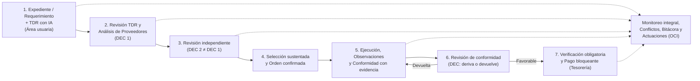

# Plan de reestructuración — Conforme

Este documento define la **estrategia, principios de UX/UI, arquitectura de datos y cambios por módulo** para llevar Conforme a su nueva dirección respetando la matriz de roles acordada en [README.md](README.md).

---

## 1. Estrategia general

### Enfoque de desarrollo: Mockup primero → Integración real después
- Cada funcionalidad se construye primero en **modo mockup navegable** (con fuentes abiertas, cruces de datos, IA y referencias simuladas) para validar rápido que el flujo, las pantallas y los controles funcionen bien en la práctica.
- Toda fuente externa (SUNAT, OECE/RNP, sanciones, vínculos societarios, conflictos de interés, lectura de TDR con IA, SIAF) vive detrás de **adaptadores desacoplados**. Cuando el flujo esté validado, se reemplaza cada adaptador mock por el sistema real sin rehacer pantallas ni lógica de negocio.
- **Motor de agentes unificado en `eve` (`investigador/`):** todo lo que involucre agentes IA corre en `eve` usando la **cuenta local de ChatGPT**, con **herramientas (`tools`) especializadas por dimensión** (actualmente `investigador/agent/agent.ts` tiene `defaultTools: false, tool: false`; se habilitarán tools robustas conectadas primero a los adaptadores mock y luego a fuentes reales).

### Los 3 pilares del sistema
1. **Control preventivo (antes de contratar):** analizar de manera integral y por dimensiones a los posibles proveedores antes de adjudicar (antecedentes, capacidad real de la empresa, personas detrás de la empresa, colusión entre postores, precio/mercado y desempeño operativo), más **análisis forense de documentación y montos (Ley de Benford)**.
2. **Anticorrupción y anticonfabulación (quién contrata y revisa):** controles para impedir colusión entre quien contrata/revisa y el proveedor (segregación estricta de roles, revisión independiente de 4 ojos por otro usuario de Abastecimiento, declaración y cruce de conflictos de intereses, trazabilidad inmutable y prohibición de resolver alertas donde el propio usuario está implicado).
3. **Control estricto de ejecución y pago (durante y al cierre):** endurecer el seguimiento para asegurar que lo que el proveedor entrega sea exactamente lo contratado, pasando de un esquema flexible/informativo a **compuertas bloqueantes** con evidencia obligatoria antes de conformar y antes de pagar.

---

## 2. Principios transversales de UX/UI (para todo el frontend)

La experiencia de uso aplica a **todas las pantallas y roles**, no solo a un módulo:

- **Menos sobreinformación (resumen primero, detalle a demanda):** mostrar de golpe lo más importante en un resumen limpio; la información técnica, documentos y fuentes detalladas se abren solo cuando el usuario decide profundizar.
- **Menos clics y cero duplicación:** el **expediente** es el eje central donde vive todo el ciclo (requerimiento, posibles proveedores, análisis, selección, entregables, conformidad, pagos y trazabilidad). El encargado no tiene que saltar entre módulos desconectados ni volver a tipear datos ya registrados.
- **Lenguaje 100 % entendible:** eliminar jerga críptica, códigos internos en pantalla (`F01`–`F11`) y mensajes ambiguos. Cada estado o alerta debe decir en español claro: **qué se encontró, por qué importa y qué acción corresponde** (o por qué está bloqueado).
- **Organización real para el trabajo diario:** bandejas ordenadas por estado y prioridad (qué te toca atender hoy, qué está en revisión, qué tiene bloqueo, qué ya cerraste), con filtros simples y notas/decisiones siempre visibles en su sitio.
- **Interacción fluida:** feedback inmediato en cada acción, sin modales innecesarios en cadena ni formularios eternos; acciones rápidas inline siempre que sea seguro.

---

## 3. Flujos aterrizados: Análisis por dimensiones + Módulo Benford

### 3.1. Análisis de proveedores por dimensiones + Consolidado (Abastecimiento)

Diseñado para ser riguroso (entorno universitario) sin saturar al agente ni marear al encargado:

1. **Entrada directa a los expedientes:** el encargado entra y ve los expedientes generados por el área usuaria (organizados por estado: pendientes de análisis, en revisión, observados, listos).
2. **Dentro del expediente:** ve los datos clave de la compra y la lista de **posibles proveedores** contemplados en el expediente (con posibilidad de agregar/ajustar postores y cotizaciones ahí mismo).
3. **Análisis por 6 dimensiones (en bloques/pestañas dentro del mismo proveedor, sin 6 pantallas separadas):**
   - El encargado puede pulsar **`Analizar todas`** (corre las 6 dimensiones en paralelo) o re-ejecutar una dimensión puntual. Las reglas objetivas corren de forma determinística (rápido, sin sobrecargar al LLM) y los agentes en `eve` con sus tools investigan y sintetizan lo documental/abierto:
     1. **Antecedentes y sanciones:** inhabilitaciones vigentes, multas, mandatos judiciales o resoluciones.
     2. **Empresa real y capacidad:** RUC, razón social, estado/condición tributaria, antigüedad, rubro real (CIIU) vs. objeto de la compra, domicilio y tamaño operativo.
     3. **Personas de interés y empresas clon:** representante legal, socios/accionistas, apoderados y encargados de cotización — cruzados contra funcionarios de la compra, otros postores y empresas previamente sancionadas.
     4. **Colusión entre postores:** datos repetidos entre cotizaciones del mismo expediente (socios, direcciones, correos, teléfonos, contactos) o patrones de falsa competencia.
     5. **Precio y mercado:** detección de sobreprecio y precio temerario (sospechosamente bajo) frente al estimado y compras históricas.
     6. **Desempeño operativo previo:** historial real de atrasos, penalidades, entregables observados/devueltos y sobrecarga/concentración de órdenes en la entidad.
4. **Resumen primero, profundizar a demanda:**
   - **Nivel 1 — Resumen por dimensión:** cada dimensión muestra en una línea su estado (🟢 Limpio / 🟡 Revisar / 🔴 Alerta) y solo los hallazgos relevantes en español claro.
   - **Nivel 2 — Profundizar:** al abrir una dimensión, el encargado ve fuentes, extractos, personas vinculadas y puede registrar notas en el mismo lugar.
5. **Botón `Consolidar evaluación`:**
   - Cruza los resultados de las 6 dimensiones para detectar **riesgos combinados** (ej. *empresa recién creada + socio vinculado + precio atípico*) y genera un **Informe consolidado formal y trazable** con veredicto final.
   - Sobre ese consolidado, el encargado compara postores, sustenta su elección, declara no conflicto de intereses y envía a **revisión independiente (`DEC 2 ≠ DEC 1`)**.

### 3.2. Nuevo módulo: Revisión documental y forense del proveedor — incl. Ley de Benford (`/documentos`)

Módulo dedicado a auditar **la documentación real presentada por los proveedores** (cotizaciones/presupuestos desagregados, propuestas técnicas, anexos, declaraciones juradas, certificados de experiencia y facturas/liquidaciones), así como análisis transversal de montos, con **UI limpia y 100 % entendible**:

- **Los 5 análisis integrados en un solo botón (`Analizar documentación`):**
  1. **Consistencia numérica y Ley de Benford:**
     - **Ley de Benford:** detecta distribuciones anómalas de dígitos en presupuestos desagregados, precios unitarios, liquidaciones o conjuntos transversales de órdenes/pagos. Incluye **aviso automático de tamaño de muestra** (ej. ≥ 30 montos con rango amplio; con pocos datos avisa *"Muestra insuficiente para conclusión estadística"* sin dar falsos positivos), gráfica limpia *Esperado vs. Observado* (dígitos 1–9) y lista directa de las partidas sospechosas.
     - **Cuadre aritmético:** verifica `cantidad × precio unitario = subtotal`, sumas totales, IGV y coincidencia entre monto en letras y monto en números.
  2. **Forense de metadatos de archivos (PDF / Excel / Word):**
     - Inspecciona autor, equipo/software creador y fechas de creación/modificación.
     - Detecta **cotizaciones gemelas** (PDFs de distintos "competidores" creados por el mismo autor/software o con minutos de diferencia) y **posible adulteración** (certificados editados tras su supuesta emisión o imágenes pegadas sobre texto).
  3. **Similitud / plagio entre postores (falsa competencia):**
     - Compara las propuestas de los distintos proveedores del mismo expediente para detectar párrafos idénticos, mismos errores ortográficos o plantillas repetidas.
  4. **Cumplimiento real frente al TDR (asistido por agente `eve`):**
     - Contrasta la propuesta presentada **punto por punto contra el TDR** (especificaciones, plazos, entregables, garantías, licencias/certificaciones exigidas) mostrando un checklist claro: ✅ *Acreditado* · ⚠️ *Incompleto / ambiguo* · ❌ *No cumple o contradice*.
  5. **Coherencia interna, vigencias y huella digital (SHA-256):**
     - Detecta errores de *"copia y pega"* entre anexos (RUC, razón social, dirección o representante distintos), documentos vencidos, certificados de experiencia con fechas anteriores a la creación de la empresa, y reutilización sospechosa de archivos idénticos en otros expedientes (SHA-256).
- **Cómo se presenta (resumen primero → profundizar a demanda):**
  - Veredicto humano claro arriba + los 5 bloques en una línea cada uno (`Montos y Benford`, `Metadatos`, `Cruce entre postores`, `Cumplimiento TDR`, `Vigencias y coherencia`).
  - Solo se expande lo que el encargado quiera revisar a fondo (página, extracto, metadato exacto o gráfica de Benford), acompañado de interpretación en lenguaje claro del agente `eve`.
- **Alcance por rol:** DEC (análisis de propuestas/documentos de postores en evaluación), Tesorería (consulta de señales documentales y de Benford antes del pago), OCI (auditoría documental y transversal de montos por proveedor/área/periodo + actuaciones de seguimiento; solo lectura operativa).

### 3.3. Prevención en el requerimiento, el TDR y la decisión interna (sin pantallas extra)

Controles preventivos que actúan **antes de adjudicar**, integrados directamente en la revisión del TDR, en el expediente y en el panel de Integridad (OCI):

1. **Detección de TDR "direccionado" (agente `eve`):**
   - Detecta marcas específicas sin *"o equivalente"*, plazos de entrega irreales (que solo cumple un proveedor previamente avisado), requisitos restrictivos desproporcionados, entregables vagos/no verificables (*"informe a satisfacción"*) y cambios sospechosos entre versiones del TDR tras recibir cotizaciones.
2. **Fraccionamiento y compras pegadas al tope (previo a la adjudicación):**
   - Alerta antes de aprobar la selección si el monto está sospechosamente cerca del tope sin licitación (ej. 95–99 % de 8 UIT) o si existen requerimientos similares recientes en la misma área o en otras unidades de la universidad.
3. **Compras duplicadas y presupuesto inflado de origen:**
   - Contrasta el requerimiento nuevo contra compras recientes en otras facultades/áreas y compara el monto estimado contra el histórico interno pagado por prestaciones equivalentes.
4. **Anticonfabulación y favoritismo interno:**
   - **Patrón de captura por funcionario:** detecta si un mismo solicitante o especialista DEC invita o adjudica reiteradamente al mismo proveedor.
   - **Justificación obligatoria de descartes:** al seleccionar al ganador, DEC debe registrar brevemente **por qué se descartó** a cada postor más barato o apto (no solo por qué ganó el elegido).
   - **Revisión independiente (`DEC 2 ≠ DEC 1`) + cruce automático de conflictos de intereses** (funcionario ↔ socios/representantes/apoderados de los postores). En la interfaz se muestra siempre como **"Revisión independiente"** (sin tecnicismos).

### 3.4. Control estricto de ejecución, conformidad y pago

Endurece la etapa posterior a la orden para que el sistema verifique de verdad que **lo entregado coincide con lo contratado** (eliminando la flexibilidad excesiva actual):

1. **Entregables con criterio verificable desde el origen (módulo de Expedientes / TDR):**
   - Al aprobarse el TDR/orden, cada entregable queda registrado con el **tipo de evidencia mínima exigida** (ej. *Acta firmada + fotos*, *Guía de remisión*, *Informe técnico*), evitando entregables genéricos que acepten cualquier archivo.
2. **Verificación inteligente de evidencias al emitir conformidad (módulo de Conformidades + agente `eve`):**
   - **Evidencia obligatoria (bloqueante):** no se puede marcar un entregable como *Cumplido* sin adjuntar sustento.
   - **Coherencia contra lo contratado (`eve`):** valida que el documento/informe adjunto corresponda realmente al entregable y expediente según el TDR, avisando en lenguaje claro si falta contenido o no corresponde.
   - **Control anti-trampa en archivos y fotos:** detecta archivos/fotos reciclados de otros expedientes (huella SHA-256) y fechas sospechosas en metadatos (EXIF/PDF anterior a la orden).
   - **Penalidad transparente:** calcula automáticamente la penalidad por atraso; si el área usuaria ingresa un monto menor (o `S/ 0`), exige registrar sustento formal de ampliación o causa no imputable.
3. **Ciclo completo de revisión y devolución (módulo de Expedientes / Conformidades):**
   - Toda conformidad emitida pasa obligatoriamente por **Revisión de Abastecimiento (DEC)**:
     - **Favorable** (con referencia de derivación) → habilita el expediente para Tesorería.
     - **Devuelta con motivo** → bloquea el pago y habilita a Área usuaria a emitir una **Conformidad v2 corregida** (preservando la v1 sellada en historial y bitácora).
4. **Compuerta dura pre-pago en Tesorería (módulo de Verificación y Pagos / Expediente):**
   - Checklist visual claro (verde/rojo) de **6 controles obligatorios**:
     1. Proveedor con evaluación preventiva aprobada y **Revisión independiente** (`DEC 2`).
     2. Cero observaciones de entrega sin subsanar.
     3. Conformidad vigente con evidencias verificadas y sello íntegro.
     4. Revisión favorable de Abastecimiento (DEC) con referencia de derivación.
     5. Penalidad descontada coherente con el atraso (o ampliación sustentada).
     6. Sin conflictos de interés ni alertas bloqueantes abiertas.
   - **Bloqueo real (UI + backend):** si falla un solo punto, el botón **`Registrar pago`** se bloquea indicando exactamente qué falta y a quién le corresponde subsanarlo. OCI monitorea todo, pero **nunca levanta bloqueos operativos**.

### 3.5. Sistema de alertas (lineamientos y recomendaciones)

> **Nota de implementación:** los tipos de alerta descritos abajo son **recomendaciones guía**, no una lista rígida. Al llegar a esta fase, el agente deberá decidir qué alertas concretas incorporar para cubrir el flujo real sin generar ruido, **definir con precisión a qué rol/bandeja dirigir cada alerta** y **evaluar si corresponde (y en qué casos) enviar notificaciones por correo electrónico**.

- **Principios obligatorios (sí fijos por matriz de roles):**
  - Distinguir claramente entre **🔴 Bloqueante** (detiene selección o pago hasta subsanar el hecho real) y **🟡 De revisión / seguimiento** (requiere descargo, aclaración o monitoreo).
  - Separar competencias: alertas preventivas (DEC + revisión independiente), operativas de ejecución/pago (Área usuaria presenta descargos; Tesorería evalúa/cierra/escala las de su competencia) y de seguimiento propio (OCI escala/cierra sin levantar jamás bloqueos operativos).
  - **Segregación estricta:** ninguna persona puede cerrar ni escalar una alerta donde figure implicada.
  - **UX limpia:** abrir por defecto en *"Por atender"*, en español directo (qué pasó, qué bloquea y acción directa al expediente, sin códigos crípticos sueltos).
- **Recomendaciones de alertas a evaluar al implementar:**
  - *Preventivas y documentales:* TDR direccionado, fraccionamiento o monto pegado al tope, proveedor inhabilitado/fachada/clon, conflicto de interés, cotizaciones gemelas (metadatos PDF), similitud entre postores, anomalía fuerte de Benford.
  - *Ejecución y pago:* entregable sin evidencia o evidencia incoherente con el TDR (`eve`), archivo/foto reciclada (SHA-256/EXIF), penalidad omitida sin sustento, conformidad devuelta por DEC, intento de pago con requisitos faltantes, misma persona en conformidad y pago.
  - *Seguimiento OCI:* alertas escaladas por Tesorería, patrones de captura/favoritismo por funcionario, anomalías transversales de Benford o conflictos graves.
- **Decisiones que debe definir el agente al construir este módulo:**
  1. **Enrutamiento exacto:** matriz clara de destinatario principal, roles con visibilidad en solo lectura y acciones permitidas por cada alerta (cuidando no alertar de investigaciones internas a la persona sospechosa/implicada).
  2. **Evaluación de envío por correo:** analizar en qué casos tiene sentido notificar por correo (ej. bloqueos críticos, derivaciones pendientes de Revisión independiente o escalamientos a OCI) frente a cuáles deben quedarse solo en la bandeja interna (para evitar spam o exposición de información sensible), implementándolo inicialmente tras un adaptador mock de notificaciones.

**Decisión de fase 6:** Tesorería resuelve las alertas operativas, otro especialista DEC resuelve las preventivas y OCI resuelve únicamente sus alertas de seguimiento. El Área usuaria ve las alertas de sus expedientes y presenta descargos cuando corresponde. Todos los cierres y escalamientos rechazan a la persona implicada. Los escalamientos operativos y preventivos abren una alerta OCI separada y no levantan el bloqueo original. Por ahora se usa la bandeja interna: el adaptador mock registra en bitácora el aviso de escalamiento a OCI, sin enviar correo. Se pospone el correo hasta contar con destinatarios institucionales verificados y reglas para no exponer investigaciones.

---

## 4. Flujo de extremo a extremo y compuertas bloqueantes

### Compuertas bloqueantes (hard gates)

| Transición | Control bloqueante (impide avanzar) | Quién subsana |
|---|---|---|
| **Requerimiento / TDR → Selección** | TDR analizado con IA y sin observaciones técnicas pendientes (corregidas o justificadas por Área usuaria). | Área usuaria |
| **Análisis de proveedores → Selección** | Cruce general ejecutado, riesgos críticos atendidos o proveedor descartado, declaración de conflicto de intereses registrada y **revisión independiente aprobada por otro usuario DEC (`DEC 2 ≠ DEC 1`)**. | DEC evaluador + DEC revisor independiente |
| **Selección → Orden confirmada** | Debe existir una selección sustentada y aprobada por DEC. **Área usuaria ya no selecciona libremente al proveedor adjudicado.** | DEC |
| **Ejecución → Conformidad** | Toda observación de entrega debe estar comunicada por DEC y subsanada con evidencia; todo entregable cumplido debe tener evidencia adjunta obligatoria. | DEC (comunicación) + Área usuaria (subsanación y evidencia) |
| **Conformidad → Revisión DEC → Pago** | Si DEC devuelve la conformidad con motivo, el expediente queda bloqueado para pago hasta que Área usuaria emita una conformidad corregida y DEC la apruebe con referencia de derivación. | Área usuaria + DEC |
| **Derivación → Registro de pago** | **Bloqueo duro en Tesorería:** no se puede registrar el pago si falta conformidad vigente, falta revisión favorable de DEC, existe observación abierta, conflicto de interés bloqueante o alerta bloqueante sin cierre válido (por alguien no implicado). **OCI nunca levanta bloqueos operativos.** | Área usuaria / DEC / Tesorería (según el bloqueo) |

---

## 5. Mapa de módulos habilitados por rol (menú y pantallas)

**Principio de orden modular:** cada funcionalidad vive en su módulo respectivo de forma ordenada y sin mezclarse con pantallas que no le corresponden, manteniendo el **expediente** como vínculo común para evitar duplicar datos.

| Módulo / Ruta | Área usuaria (`inf1`) | Abastecimiento (`dec1`, `dec2`) | Tesorería (`tes1`) | OCI (`oci1`) |
|---|:---:|:---:|:---:|:---:|
| **Expedientes** `/expedientes` *(eje principal)* | Solo su área. Registra requerimientos, analiza TDR con IA, corrige/justifica obs. técnicas, registra orden aprobada, entregables y observaciones | Todos. Revisa TDR, entra a los expedientes para evaluar postores, comunica observaciones y revisa conformidad | Todos. Consulta expediente, estado de bloqueos y trazabilidad | Todos (solo lectura) + seguimiento |
| **Análisis de proveedores** `/prevencion` *(módulo preventivo)* | ❌ | Bandeja de expedientes por evaluar, análisis por 6 dimensiones, consolidado, comparativo, sustento y **Revisión independiente (`dec2`)** | Solo lectura (verificación pre-pago) | **Monitoreo (solo lectura)** |
| **Revisión documental y forense (Benford)** `/documentos` *(nuevo)* | ❌ | Analiza documentación del proveedor (Benford, cuadre aritmético, metadatos PDF, similitud entre postores, cumplimiento TDR y vigencias) | Consulta de señales documentales y de Benford antes del pago | **Auditoría documental y transversal de montos** (por proveedor, área o periodo) + seguimiento |
| **Conformidades** `/conformidad` | Emite y corrige conformidades (v1, v2…) con evidencia obligatoria y verificación `eve` | Revisa conformidad (favorable con derivación o devuelta con motivo) | Solo lectura | Solo lectura |
| **Verificación y Pagos** `/pagos` *(nuevo)* | ❌ | Solo lectura | **Checklist pre-pago bloqueante de 6 puntos** y registro de pago (solo si no hay bloqueos) | Solo lectura |
| **Integridad y Conflictos** `/integridad` *(nuevo)* | Declaración propia (si aplica) | Declaración obligatoria en evaluaciones | Consulta de bloqueos | **Monitoreo de riesgos preventivos, conflictos de intereses, revisiones independientes y actuaciones de seguimiento** |
| **Alertas** `/alertas` | Solo su área; presenta descargos. No cierra ni escala | Ve alertas y presenta descargos; **no resuelve alertas donde está implicado** | Reevalúa, cierra/escala alertas **de su competencia** (nunca si está implicada) | Escala/cierra **alertas de seguimiento propias**; nunca levanta bloqueos operativos |
| **Indicadores** `/indicadores` | De su área | Globales + estado de evaluaciones | Globales + pagos y bloqueos | Globales + riesgos, conflictos y seguimiento |
| **Bitácora e Integridad** `/bitacora` | ❌ | ❌ | ❌ | Completa + verificación criptográfica + actuaciones OCI |
| **Verificar sello** `/verificar` | Sí (y público) | Sí (y público) | Sí (y público) | Sí (y público) |

---

## 6. Cambios en base de datos y siembra

Se crearán nuevas migraciones a partir de `migraciones/010_*.sql` y se actualizarán `conforme/modelos.py` y `scripts/sembrar.py`.

### 6.1. Usuarios demo (`scripts/sembrar.py`)
- Agregar un segundo usuario de Abastecimiento (**`dec2`**) con su propia `Persona` para probar el flujo de **revisión independiente (4 ojos)** (`dec1` evalúa → `dec2` contrarrevisa) y la prohibición de autoevaluarse o cerrar alertas propias.

### 6.2. Expediente como eje, posibles proveedores y TDR (`migraciones/010_expediente_tdr_postores.sql`)
- Extender **`expediente`**:
  - `estado_flujo` (`requerimiento`, `tdr_observado`, `en_evaluacion_proveedores`, `pendiente_revision_independiente`, `orden_registrada`, `en_ejecucion`, `observado`, `conformidad_emitida`, `conformidad_devuelta`, `derivado_tesoreria`, `pagado`).
  - Permitir que `proveedor_id` y `numero_orden` sean `NULL` mientras el expediente está en etapa de requerimiento / evaluación de proveedores (solo se fijan al quedar aprobada la selección de DEC).
- Nueva tabla **`expediente_postor`** (posibles proveedores vinculados al expediente):
  - `id`, `expediente_id`, `ruc`, `razon_social`, `monto_cotizado`, `plazo_dias`, `contacto_nombre`, `contacto_correo`, `contacto_telefono`, `proforma_ref`, `cumple_tdr`, `estado` (`pendiente`, `analizado`, `consolidado`, `descartado`, `seleccionado`), `motivo_descarte`, `analisis_dimensiones` (`JSONB`: resultado independiente por cada una de las 6 dimensiones con fuentes y detalle), `informe_consolidado` (`JSONB`: síntesis cruzada, riesgos combinados y veredicto final), `notas_encargado`, `analizado_en`, `consolidado_en`, `creado_en`.
- Nueva tabla **`revision_documental`** (auditoría de documentos presentados por el proveedor + análisis Benford):
  - `id`, `ambito` (`documento_proveedor` | `expediente` | `transversal`), `expediente_id` (opcional), `postor_id` (opcional), `archivos` (`JSONB`: nombre, mime, tamano, sha256, metadatos extraídos), `resultados_bloques` (`JSONB`: cuadre aritmético, forense de metadatos, similitud entre postores, checklist cumplimiento TDR, coherencia interna y vigencias), `benford` (`JSONB`: total_montos, muestra_suficiente, esperado vs. observado 1–9, MAD/chi-cuadrado, nivel_anomalia, partidas_sospechosas), `veredicto` (`conforme` | `revisar` | `anomalia`), `resumen_agente` (`TEXT`), `creado_por`, `creado_en`.
- Nueva tabla **`tdr_observacion`**:
  - `id`, `expediente_id`, `origen` (`ia` | `abastecimiento`), `autor_id`, `detalle`, `severidad` (`bloqueante` | `advertencia`), `estado` (`pendiente` | `corregida` | `justificada`), `respuesta_area`, `respondido_por`, `respondido_en`.

### 6.3. Control preventivo, 4 ojos y conflictos (`migraciones/011_prevencion_integridad.sql`)
- Vincular **`revision_previa`** al expediente (`expediente_id` FK) y agregar segregación de 4 ojos:
  - `evaluador_id` (`usuario.id`), `revisor_independiente_id` (`usuario.id`, con constraint `CHECK (revisor_independiente_id IS NULL OR revisor_independiente_id <> evaluador_id)`).
  - `estado_revision_independiente` (`pendiente`, `aprobada`, `observada`), `comentario_revision_independiente`, `revisado_independiente_en`.
  - `proveedor_seleccionado_ruc`, `sustento_seleccion`.
- Nueva tabla **`conflicto_interes`**:
  - `id`, `expediente_id`, `revision_previa_id`, `persona_id`, `proveedor_ruc`, `tipo` (`declaracion_negativa`, `declaracion_conflicto`, `vinculo_detectado`), `descripcion`, `bloqueante` (`BOOLEAN`), `estado` (`declarado`, `en_revision`, `mitigado`, `confirmado`), `registrado_en`.

### 6.4. Conformidad versionable y verificación pre-pago (`migraciones/012_ejecucion_pago_bloqueante.sql`)
- Extender **`entregable`**:
  - `criterio_evidencia` (`TEXT`: tipo de evidencia mínima esperada según el TDR).
- Extender **`conformidad`**:
  - `version` (`INTEGER NOT NULL DEFAULT 1`), `vigente` (`BOOLEAN NOT NULL DEFAULT true`), `sustento_penalidad` (`TEXT`: obligatorio cuando la penalidad aplicada es menor a la calculada por atraso), `verificacion_evidencias` (`JSONB`: resultado de verificación `eve`, SHA-256 y metadatos), `estado_revision_dec` (`pendiente`, `favorable`, `devuelta`), `referencia_derivacion`, `motivo_revision_dec`, `revisado_dec_por`, `revisado_dec_en`.
  - Permite emitir una conformidad corregida (`version = 2`) cuando DEC devuelve la anterior, manteniendo intacto el sellado y el historial inmutable.
- Nueva tabla **`verificacion_pago`**:
  - `id`, `expediente_id`, `verificado_por`, `checklist` (`JSONB`), `bloqueos_activos` (`JSONB`), `apto_para_pago` (`BOOLEAN`), `creado_en`.
  - `pago.verificacion_pago_id` (FK a la verificación que habilitó el pago).

### 6.5. Separación de alertas y actuaciones OCI (`migraciones/013_alertas_y_oci.sql`)
- Extender **`alerta`**:
  - `ambito` (`operativa_tesoreria`, `preventiva_dec`, `seguimiento_oci`), `bloqueante` (`BOOLEAN NOT NULL DEFAULT false`).
- Nueva tabla **`actuacion_oci`**:
  - `id`, `entidad` (`expediente` | `revision_previa` | `conflicto_interes`), `entidad_id`, `tipo` (`observacion_seguimiento`, `requerimiento_info`, `recomendacion`, `alerta_seguimiento`), `descripcion`, `autor_id`, `creado_en`.
  - Toda actuación se registra en `bitacora` y **nunca modifica decisiones ni levanta bloqueos operativos**.

---

## 7. Qué se debe mover/cambiar por rol (Backend + Frontend)

### 7.1. Área usuaria (`inf1`)
- **Quitar / restringir:**
  - Quitar selección libre del proveedor adjudicado al crear orden; solo puede registrar requerimiento (con posibles postores/cotizaciones referenciales si aplica) y confirmar la orden sobre la selección ya aprobada por DEC.
  - Exigir evidencia obligatoria por cada entregable cumplido al registrar conformidad (bloqueante, no solo alerta R1).
- **Mover / agregar:**
  - Registro de requerimiento + análisis de TDR con IA (entregables + observaciones técnicas) y flujo simple para corregir o justificar observaciones técnicas.
  - Reemisión de conformidad cuando DEC la devuelve con motivo.

### 7.2. Abastecimiento / DEC (`dec1`, `dec2`)
- **Quitar / restringir:**
  - Prohibir que el mismo usuario DEC haga la revisión independiente de su propia evaluación (`evaluador_id <> revisor_independiente_id`) o cierre alertas donde figura implicado.
  - Mantener bloqueo sobre emitir conformidades o decidir suficiencia técnica de entregables.
  - Eliminar jerga (`F01`–`F11`, modales repetitivos de 12 checks manuales, consola técnica confusa) en la interfaz de análisis.
- **Mover / agregar:**
  - Acceso directo a los expedientes generados por el área usuaria, con la lista de posibles proveedores y análisis por **6 dimensiones** + botón **`Consolidar evaluación`** (agentes en `eve` con tools dedicadas sobre cuenta local de ChatGPT + cruces determinísticos).
  - Vista de **resumen ejecutivo claro + profundización bajo demanda** con notas del encargado y comparativo limpio entre postores.
  - Acceso al nuevo módulo **Revisión documental y forense (`/documentos`)** para auditar cotizaciones, presupuestos (Benford y cuadre), metadatos PDF, similitud entre postores, cumplimiento TDR y vigencias.
  - Revisión de TDR (formular observaciones técnicas), declaración de conflicto de intereses, sustento de selección y bandeja de **revisión independiente** para `dec2`.
  - Mantener comunicación de observaciones al proveedor (canal + plazo) y revisión de conformidad (favorable con derivación o devuelta con motivo).

### 7.3. Tesorería (`tes1`)
- **Quitar / restringir:**
  - **Bloqueo duro en `registrar_pago`**: impide pagar si falta conformidad vigente, falta revisión favorable de DEC, hay observaciones sin subsanar, conflicto de interés bloqueante, falta checklist verificado o existen alertas bloqueantes abiertas.
  - Restringir cierre/escalamiento a alertas de competencia de Tesorería (`operativa_tesoreria`), nunca si está implicada.
- **Mover / agregar:**
  - Checklist visual limpio de verificación pre-pago dentro del expediente (mostrando en verde/rojo qué cumple y qué bloquea) + vista solo lectura del resultado consolidado del proveedor y señales de Benford.

### 7.4. Órgano de Control Institucional / OCI (`oci1`)
- **Quitar / restringir:**
  - Garantizar en backend que OCI nunca modifique documentos, evaluaciones, conformidades ni pagos, y **nunca levante bloqueos operativos**.
  - Separar las alertas que cierra/escala OCI (`seguimiento_oci`) de las operativas de Tesorería.
- **Mover / agregar:**
  - Abrir visibilidad de solo lectura a todos los análisis por dimensiones, informes consolidados, revisiones independientes, TDR y sustentos de selección.
  - Acceso completo de lectura y auditoría transversal en el módulo **Revisión documental y forense (Ley de Benford)** (por proveedor, área o periodo).
  - Panel **`/integridad`** con conflictos de intereses, evaluaciones preventivas y decisiones sustentadas + registro de **actuaciones de seguimiento** encadenadas en bitácora.

---

## 8. Orden recomendado de implementación (fases iterativas con mockups)

1. **Fase 1 — Cimientos (BD + roles + navegación limpia + `eve`):** migraciones `010`–`013`, modelos, `dec2` en siembra, matriz de permisos en `conforme/permisos.py`, menú simplificado en `frontend/src/marco.jsx` y configuración base de agentes/tools en `eve` (`investigador/`) con cuenta local de ChatGPT.
2. **Fase 2 — Rediseño UX/UI del Análisis de Proveedores por 6 dimensiones + Consolidado:** reemplazar la ficha recargada actual por el flujo limpio desde expedientes (6 dimensiones en paralelo/individuales, resumen claro + profundizar, botón `Consolidar evaluación`, comparativo, sustento y revisión independiente `dec2`).
3. **Fase 3 — Nuevo módulo: Revisión documental y forense del proveedor (`/documentos`):** Benford (con aviso de muestra + gráfica + partidas sospechosas), cuadre aritmético, forense de metadatos de archivos, similitud entre postores, cruce punto a punto contra TDR con `eve` y verificación de vigencias/SHA-256.
4. **Fase 4 — Requerimiento + Análisis de TDR con IA:** separar requerimiento/TDR (observaciones técnicas + corrección/justificación) de la orden confirmada; quitar selección libre de proveedor a Área usuaria.
5. **Fase 5 — Ejecución estricta y Pago bloqueante:** evidencia obligatoria en conformidad, reemisión tras devolución de DEC, checklist visual pre-pago y bloqueo duro en Tesorería.
6. **Fase 6 — Monitoreo integral OCI y mejora transversal de módulos:** visibilidad total en solo lectura sobre prevención/documentos/conflictos, panel `/integridad`, actuaciones de seguimiento, separación de alertas + enrutamiento/notificaciones y pulido UX/UI de todos los módulos restantes (`Login`, `Indicadores`, `Bitácora`, `Verificar sello`, etc.).
7. **Fase 7 — Integración real (post-validación de mockups):** reemplazar adaptadores simulados (SUNAT, OECE, vínculos, IA TDR, SIAF, correo) por fuentes reales manteniendo intactos el flujo y la UX validada.

---

## 9. Criterios de autonomía, rigor normativo y calidad de entrega

Directrices obligatorias para el agente que ejecute este plan:

1. **Autonomía técnica y funcional con criterio:** si durante la implementación detecta mejoras necesarias, ajustes de flujo o la conveniencia de **agregar algún nuevo módulo** para mantener el orden y la claridad del sistema, debe proponerlo/aplicarlo respetando siempre la matriz de roles y los principios de UX/UI.
2. **Apego estricto a la ley y normativas aplicables:** toda regla, compuerta bloqueante, plazo, penalidad, causal de impedimento, manejo de conflictos de intereses y competencia de cada rol debe sujetarse estrictamente a lo que la normativa peruana vigente permite (Ley N.º 32069 de Contrataciones Públicas y su Reglamento —D.S. N.º 009-2025-EF—, Ley N.º 28716 de Control Interno, Modelo de Integridad Pública y normativa del Sistema Nacional de Control / competencias del OCI sin injerencia operativa). Ningún control puede contradecir la ley; los umbrales de trabajo no fijados por norma deben quedar claramente parametrizados y diferenciados.
3. **Mejora integral de todos los módulos (incluidos los no detallados):** no limitarse solo a los módulos nuevos. Revisar y elevar tanto el **UX/UI** (orden, claridad, menos clics, menos sobreinformación, cero jerga confusa, fluidez) como el **funcionamiento** de todos los módulos existentes (`Login`, `Expedientes`, `Conformidades`, `Alertas`, `Indicadores`, `Bitácora`, `Verificar sello`, reportes PDF, etc.).
4. **Uso de skills de diseño:** apoyarse en skills de diseño frontend/UI (`frontend-design`, `impeccable`) siempre que aporte valor para lograr una interfaz institucional pulida, coherente, accesible y fácil de entender.
5. **Verificación end-to-end (E2E) y entrega de MVP fino:**
   - Probar de principio a fin (**end-to-end**) cada flujo real con todos los roles (`inf1`, `dec1`, `dec2`, `tes1`, `oci1`): casos felices, bloqueos duros (intentar pagar con controles pendientes, autoevaluarse, cerrar alerta propia, subir evidencia vacía o reciclada), devoluciones y reemisión de conformidades, análisis por dimensiones + consolidado, módulo documental/Benford y verificación de integridad de bitácora/sellos.
   - Ejecutar la batería completa de pruebas automatizadas (`pytest`) y la compilación limpia del frontend (`npm run build`), dejando el MVP completamente fino, sin errores en consola, sin flujos rotos ni estados inconsistentes.
